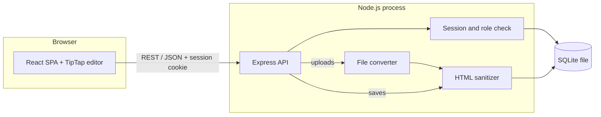
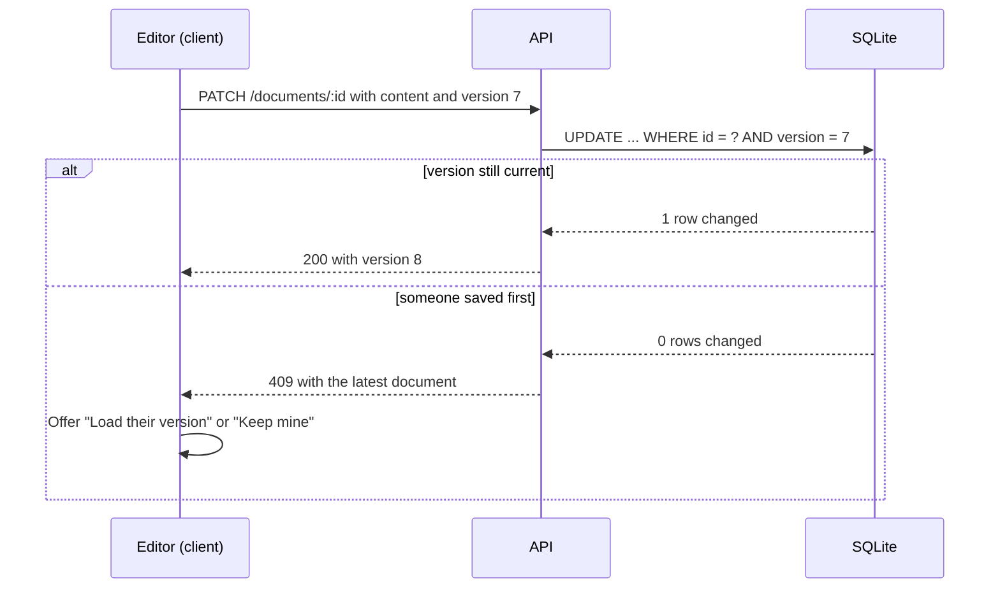

# Architecture note

This note explains how Inkwell is put together and why. For setup steps and the full API table, see the
[README](README.md).

## 1. Overview

Inkwell is a single-page React app backed by one Node.js process that serves a REST API and stores
everything in a SQLite file. There are no other services: no separate database server, no queue, and no
file storage.



| Layer | Responsibility | Main files |
| --- | --- | --- |
| Client | Routing, dashboard, editor, autosave, sharing UI | `client/src/components/*` |
| Core | Sessions, authorization, documents, sharing, version checks. Framework-free and synchronous | `shared/core.js` |
| HTTP API | Maps the core onto HTTP: cookies, uploads, static files, error responses | `server/app.js` |
| Conversion | `.docx`, `.md`, and `.txt` files to HTML, plus sanitization | `shared/content.js`, `server/convert.js` |
| Storage | Schema, foreign keys, seed data | `shared/schema.js`, `server/db.js` |

In development, Vite serves the client and forwards `/api` requests to Express. In production, Express
serves the built client and the API from the same process and port. The same core also runs inside the
browser for the hosted GitHub Pages demo (see [section 7](#7-deployment-two-editions)).

## 2. Data model

```
users ──< documents            (owner_id; exactly one owner per document)
users ──< document_shares >── documents   (role: viewer | editor)
users ──< sessions
```

- **Documents** hold the title, the content as sanitized HTML, an integer `version`, and audit fields
  (`updated_at`, `updated_by`, `source_filename`).
- **Shares** use the composite key `(document_id, user_id)`. Granting access again updates the existing
  row, so changing a role is the same operation as granting access.
- **Integrity** is enforced by the database. Foreign keys cascade, so deleting a document removes its
  shares. Indexes on `documents.owner_id` and `document_shares.user_id` support the two dashboard
  queries.

## 3. Key flows

### Authorization

Every document operation resolves the caller's role in one place, the `loadDoc(user, id, minRole)`
function in `shared/core.js`:

1. The owner of the document gets the role `owner`.
2. Otherwise, a matching row in `document_shares` gives `editor` or `viewer`.
3. Otherwise, the server responds **404**, so outsiders cannot tell whether a document exists.
4. If the role ranks below the minimum the route requires (viewer < editor < owner), the server
   responds **403**.

The client hides controls the user isn't allowed to use, but that is only for convenience. The server is
the only place access is enforced.

### Saving and concurrent edits

The client debounces edits by 0.8 seconds and keeps at most one save request in flight; any edits made
during a save are queued for the next request. Each save includes the `version` it was based on:



The check-and-update happens in a single SQL statement, so two saves can never both succeed against the
same version. Open documents poll every 4 seconds. When the local copy has no unsaved changes, newer
versions are applied without adding to the user's undo history. A change in the user's role is detected
by the same poll and switches the page to the new role.

### File import

An upload is limited to one file of at most 5 MB, with an allowed extension. The file is held in memory
and converted:

| Format | Converter |
| --- | --- |
| `.docx` | mammoth, with underline mapped explicitly |
| `.md` | marked (GitHub-flavored) |
| `.txt` | Paragraphs and line breaks, with HTML escaped |

The result is sanitized and then either stored as a new document or returned for insertion at the cursor.
The original file is never written to disk; only the resulting HTML and the filename are kept.

## 4. Security

- **Stored content.** Every write and import passes through an allow-list sanitizer that matches the
  editor's schema: headings, marks, lists, quotes, code, and links. Links may use only `http`, `https`,
  or `mailto`, and are forced to `rel="noopener noreferrer nofollow"`. The only inline style kept is
  `text-align`. This prevents stored cross-site scripting even from clients that bypass the editor.
- **Sessions.** Each session is a random 256-bit token kept in an `HttpOnly`, `SameSite=Lax` cookie and
  looked up on the server. Login is mocked (choose a seeded account), but nothing after login trusts the
  client.
- **Input limits.** JSON bodies are limited to 2 MB, uploads to 5 MB, and titles to 200 characters.
  Request bodies are type-checked before use.

## 5. Decisions and trade-offs

| Decision | Why | Cost |
| --- | --- | --- |
| HTML as the stored format | It is what both the imports and the editor produce, and it is easy to inspect and debug | Structure is only as strict as the sanitizer's allow-list; TipTap's JSON format would be stricter |
| Optimistic concurrency instead of CRDTs | Small and predictable, and no edit is ever lost silently | No live co-typing; when two people collide, the second person has to choose a version |
| Polling instead of WebSockets | Stateless server and simple to run | Up to 4 seconds of delay, and the full document is fetched on each poll |
| SQLite through the built-in `node:sqlite` | No native build and no separate database server; one file to back up | Single node only, and writes are serialized |
| Mocked login with real sessions | Keeps the scope small while authorization stays genuine | Not suitable for real users as it stands |

## 6. Path to production

1. **Authentication.** Replace the login route with OIDC or password authentication, and add session
   expiry, rotation, and CSRF tokens.
2. **Real-time collaboration.** Use Yjs with TipTap's collaboration extension over WebSockets. This
   replaces both polling and version conflicts.
3. **Storage.** Move to Postgres, with the same schema, when more than one app server is needed, and add
   a `document_revisions` table for history and restore.
4. **Operations.** Add rate limiting on login and upload, structured logs, metrics, and end-to-end tests
   with Playwright.

## 7. Deployment: two editions

GitHub Pages serves static files only, so the hosted demo can't run the Node server. Instead, the same
client is built a second way, with the API running inside the browser.

| | Server-backed edition | Browser-only edition (live demo) |
| --- | --- | --- |
| Where it runs | Node.js process (`npm run dev` / `npm start`) | GitHub Pages: https://sujaychandrakoyyalamudi.github.io/inkwell-docs/ |
| Rules | `shared/core.js` behind Express | The same `shared/core.js`, called directly by `client/src/static/backend.js` |
| SQLite | `node:sqlite`, file on disk | sql.js (SQLite compiled to WebAssembly), snapshotted to `localStorage` |
| Sanitizer | sanitize-html | DOMPurify, configured from the same allow-list |
| `.docx` import | mammoth (Node build) | mammoth (browser build, loaded only when needed) |
| Who shares data | Everyone using the server | Everyone signed in **in the same browser**; there is no server, so data stays on that device |

- **How the browser edition plugs in.** `client/src/api.js` sends each request to the in-browser backend
  instead of `fetch` when the app is built with `vite build --mode static`. The backend answers with the
  same JSON and status codes as the server. Vite removes this code path from the server-backed build, so
  that build does not ship sql.js, mammoth, or DOMPurify.
- **Persistence and tabs.** Each write snapshots the database to `localStorage` synchronously, so a save
  completes even if the tab is closing. A revision counter lets other open tabs reload before their next
  request, so version conflicts are still detected across tabs.
- **Release pipeline.** `.github/workflows/pages.yml` runs on every push to `main`. It installs
  dependencies, runs all tests, builds the static edition, and publishes it to Pages. If a test fails,
  nothing is deployed.
- **Server-backed hosting.** `render.yaml` describes the server-backed edition for Render, ready to use
  if a shared, multi-device demo is needed.
