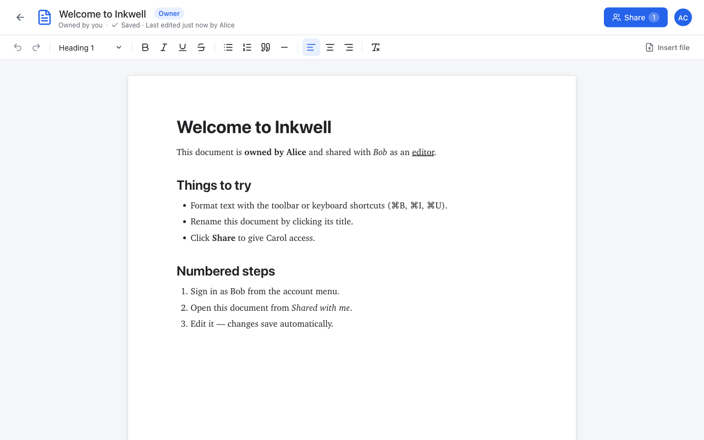

# Inkwell

A lightweight collaborative document editor. You can write and format documents in the browser, import
existing files, and share documents with other users as editors or viewers. Everything is stored in
SQLite.



## Table of contents

- [Features](#features)
- [Getting started](#getting-started)
- [Walkthrough](#walkthrough)
- [Feature details](#feature-details)
- [Architecture](#architecture)
- [API reference](#api-reference)
- [Testing](#testing)
- [Configuration](#configuration)
- [Design decisions](#design-decisions)
- [Limitations and roadmap](#limitations-and-roadmap)

---

## Features

- **Rich-text editing.** Headings, bold, italic, underline, strikethrough, bulleted and numbered lists,
  block quotes, alignment, and undo/redo, from the toolbar or with keyboard shortcuts.
- **Autosave.** Changes save a moment after you stop typing, and a status indicator shows when they are
  saved.
- **File import.** A `.docx`, `.md`, or `.txt` file can become a new document, or its content can be
  inserted into an existing draft.
- **Sharing.** The owner of a document grants **Editor** or **Viewer** access. The dashboard keeps
  *Owned by me* and *Shared with me* separate.
- **Safe concurrent editing.** If two people save over each other, the second save is refused instead of
  silently overwriting the first. Collaborators' changes appear in open documents automatically.
- **Persistence.** Documents, formatting, and sharing are stored in SQLite and survive refreshes and
  server restarts.

## Getting started

### Prerequisites

- **Node.js 22.13 or later.** Inkwell uses Node's built-in `node:sqlite` module, so there are no native
  dependencies to compile.
- npm

### Install and run

```bash
git clone https://github.com/sujaychandrakoyyalamudi/inkwell-docs.git
cd inkwell-docs
npm install
npm run dev
```

Open **http://localhost:5173**.

On first start, the server creates `data/inkwell.db` and seeds it with demo accounts and documents.

### Demo accounts

Sign-in is mocked: choose an account on the sign-in screen, with no password. To switch users, open the
avatar menu in the top-right corner.

| Account | Email | Seeded content |
| --- | --- | --- |
| Alice Chen | `alice@example.com` | Owns *Welcome to Inkwell*, shared with Bob as an editor |
| Bob Martinez | `bob@example.com` | Owns *Q3 planning notes*, shared with Alice as a viewer |
| Carol Singh | `carol@example.com` | No documents. Use this account to test sharing |

### Scripts

| Command | Description |
| --- | --- |
| `npm run dev` | Starts the API on port 3001 and the Vite dev server on port 5173, both reloading on changes |
| `npm test` | Runs the API test suite against an in-memory database |
| `npm run build` | Builds the client into `dist/` |
| `npm start` | Runs the production server, which serves both the app and the API on `PORT` (default 3001) |
| `npm run seed:reset` | Deletes the local database so the next start re-seeds demo data. Stop the server first |

## Walkthrough

This takes about two minutes and covers each core feature.

1. **Sign in as Alice.** Her dashboard lists the documents she owns separately from those shared with
   her. Each row shows a role badge.

   

2. **Edit a document.** Open *Welcome to Inkwell*, format some text, and click the title to rename it.
   The status under the title changes from *Unsaved changes* to *Saving…* to *Saved*. Refresh the page,
   and your changes are still there.

3. **Share it.** Click **Share**, add Carol as a **Viewer**, and click **Share** again. In the same
   dialog you can change roles or remove access.

   

4. **Check the viewer's experience.** Switch to Carol from the avatar menu. The document is now
   read-only: the toolbar is hidden and a banner explains the access level.

   

5. **Collaborate.** Switch to Bob, who is an editor, and make a change. Switch back to Carol and the
   change is there. A document that is already open picks up collaborators' saves within a few seconds.

6. **Import a file.** On the dashboard, click **Import file**, or drag a file onto the page. Sample
   files are in [`samples/`](samples).

## Feature details

### Editing

| Action | Toolbar | Shortcut (macOS / Windows) |
| --- | --- | --- |
| Bold, italic, underline | **B** *I* <u>U</u> | ⌘B, ⌘I, ⌘U / Ctrl+B, Ctrl+I, Ctrl+U |
| Strikethrough | S̶ | ⌘⇧S / Ctrl+Shift+S |
| Normal text, Heading 1–3 | Style menu | — |
| Bulleted or numbered list | List buttons | ⌘⇧8, ⌘⇧7 / Ctrl+Shift+8, Ctrl+Shift+7 |
| Block quote, horizontal line, alignment, clear formatting | Toolbar | — |
| Undo or redo | Arrows | ⌘Z, ⌘⇧Z / Ctrl+Z, Ctrl+Shift+Z |
| Save now | — | ⌘S / Ctrl+S |

- **Autosave.** Changes save 0.8 seconds after you stop typing, and whenever the title field loses
  focus. Only one save is sent at a time; edits made while a save is in progress are queued for the next
  one.
- **Leaving the page.** Pending changes are saved before you leave the editor. If a save is still in
  progress, the browser asks before closing the tab.
- **Titles.** Titles are trimmed and capped at 200 characters. An empty title becomes
  *Untitled document*.

### File import

| Format | Extensions | Converter | What is kept |
| --- | --- | --- | --- |
| Word | `.docx` | [mammoth](https://github.com/mwilliamson/mammoth.js) | Headings, bold, italic, underline, strikethrough, lists, links |
| Markdown | `.md`, `.markdown` | [marked](https://marked.js.org) (GitHub-flavored) | Headings, emphasis, lists, block quotes, code, links |
| Plain text | `.txt` | Built in | Paragraphs (separated by blank lines) and line breaks |

- **Two ways to import.** **Import file** on the dashboard, or a file dropped onto the dashboard,
  creates a new document. The dashboard shows the original filename next to it. **Insert file** in the
  editor toolbar puts the content at the cursor.
- **Limits.** One file per upload, up to **5 MB**. The supported types are listed next to every upload
  control, and the server rejects anything else with a clear error message.
- **Not supported.** Embedded images and table layout are dropped; table text is kept as plain text.
  Legacy `.doc` files, PDFs, and other formats are rejected.

### Sharing and permissions

Every document has exactly one **owner**: the user who created or imported it. The owner can share it
with other users by email.

| Capability | Owner | Editor | Viewer |
| --- | :---: | :---: | :---: |
| Open and read | ✓ | ✓ | ✓ |
| See who has access | ✓ | ✓ | ✓ |
| Edit content and rename | ✓ | ✓ | — |
| Insert content from a file | ✓ | ✓ | — |
| Share, change roles, remove people | ✓ | — | — |
| Remove their own access | — | ✓ | ✓ |
| Delete the document | ✓ | — | — |

- **Enforced on the server.** The API checks every permission. The interface only reflects what the API
  allows.
- **No information leaks.** Users without access get **404 Not Found** rather than 403, so they cannot
  tell whether a document exists.
- **Access changes reach open documents.** If your role changes while a document is open, the page
  updates to match within a few seconds. If your access is removed, you see a "Document unavailable"
  page.

### Persistence

- **Storage.** Data lives in a single SQLite file, `data/inkwell.db` by default, using write-ahead
  logging (WAL).
- **Content format.** Documents are stored as sanitized HTML, which is the editor's native format, so
  formatting round-trips exactly. You can inspect the data with any SQLite client:

  ```bash
  sqlite3 data/inkwell.db "SELECT title, updated_at FROM documents;"
  ```

## Architecture

### Tech stack

| Layer | Technology |
| --- | --- |
| Frontend | React 19, [TipTap 3](https://tiptap.dev) (built on ProseMirror), Vite, lucide-react icons |
| Backend | Node.js, Express 5, multer (uploads), sanitize-html |
| Database | SQLite via the built-in `node:sqlite` module |
| Testing | `node:test`, supertest |

### Project structure

```
├── client/                    React single-page app (Vite root)
│   ├── index.html
│   └── src/
│       ├── App.jsx            Session check and routing
│       ├── api.js             REST client
│       ├── lib.js             Router, formatting helpers, shared constants
│       ├── styles.css
│       └── components/
│           ├── Login.jsx          Demo account picker
│           ├── Dashboard.jsx      Owned / shared lists, create, import, drag-and-drop
│           ├── EditorPage.jsx     Editor, autosave queue, conflict handling, live refresh
│           ├── Toolbar.jsx        Formatting controls, insert-from-file
│           ├── ShareDialog.jsx    Grant, change, and revoke access
│           ├── AccountMenu.jsx    Switch user, sign out
│           └── ui.jsx             Avatar, badges, modal, toasts
├── server/
│   ├── index.js               Entry point and environment configuration
│   ├── app.js                 Express app: auth, documents, sharing, import routes
│   ├── db.js                  Schema and seed data
│   ├── convert.js             File-to-HTML conversion and the HTML sanitizer
│   └── reset.js               Deletes the local database
├── tests/api.test.js          API test suite
├── samples/                   Example .docx, .md, and .txt files
└── docs/screenshots/          Images used in this README
```

### Data model

```sql
users            (id, email UNIQUE, name, color)
sessions         (token PK, user_id → users, created_at)
documents        (id UUID PK, owner_id → users, title, content, version,
                  source_filename, created_at, updated_at, updated_by → users)
document_shares  (document_id → documents, user_id → users,
                  role CHECK IN ('viewer', 'editor'), created_at,
                  PRIMARY KEY (document_id, user_id))
```

Foreign keys cascade on delete, so deleting a document also removes its shares.

### How saving works

1. The editor sends `PATCH /api/documents/:id` with the new content and the `version` it was based on.
2. The server applies the change only if that version is still current, using a single conditional
   `UPDATE … WHERE version = ?`. On success it increments the version.
3. If another user saved first, the server returns **409 Conflict** along with the latest copy. The
   editor then shows a banner with two choices: **Load their version** or **Keep mine**.
4. Open documents poll every 4 seconds. While you have no unsaved changes, newer versions are applied
   without affecting your undo history.

## API reference

All endpoints are under `/api` and use JSON, except file uploads, which use `multipart/form-data` with
the file in a field named `file`. Every endpoint except `/users` and `/auth/*` requires a session
cookie.

| Method | Endpoint | Access | Description |
| --- | --- | --- | --- |
| `GET` | `/users` | Public | Lists demo accounts |
| `POST` | `/auth/login` | Public | Starts a session. Body: `{ email }` |
| `POST` | `/auth/logout` | Signed in | Ends the session |
| `GET` | `/auth/me` | Public | Returns the current user, or `null` |
| `GET` | `/documents` | Signed in | Returns `{ owned, shared }` document lists |
| `POST` | `/documents` | Signed in | Creates a document. Body: `{ title?, content? }` |
| `POST` | `/documents/import` | Signed in | Creates a document from an uploaded file |
| `GET` | `/documents/:id` | Any role | Returns the document, including the caller's role |
| `PATCH` | `/documents/:id` | Owner, editor | Saves changes. Body: `{ title?, content?, version }`. Returns `409` on a version conflict |
| `DELETE` | `/documents/:id` | Owner | Deletes the document |
| `GET` | `/documents/:id/shares` | Any role | Lists the owner and collaborators |
| `POST` | `/documents/:id/shares` | Owner | Grants access or changes a role. Body: `{ email, role }` |
| `DELETE` | `/documents/:id/shares/:userId` | Owner, or that user | Revokes access, or leaves the document |
| `POST` | `/convert` | Signed in | Converts an uploaded file to HTML without saving it |

Errors use the shape `{ "error": "message" }` with a matching HTTP status code.

## Testing

```bash
npm test
```

The suite has 24 tests that run against a fresh in-memory database. It covers:

- **Authentication.** Session required, sign-in and sign-out, unknown accounts.
- **Documents.** Create, rename, edit, and reopen with formatting preserved; input validation; delete.
- **Security.** Scripts, event handlers, and `javascript:` URLs are removed from stored content.
- **Concurrency.** A save based on an outdated version is rejected with `409`.
- **Sharing.** Viewers are read-only. Editors can edit but cannot manage access. Revoking and leaving
  work. Outsiders get `404`. Deleting a document removes it for collaborators.
- **Import.** `.docx`, `.md`, and `.txt` conversion using the files in `samples/`; unsupported,
  oversized, and corrupt files are rejected.
- **Persistence.** Data survives closing and reopening the database file.

The user-interface flows were verified manually in the browser: editing, autosave, sharing, switching
users, view-only mode, conflict resolution, file import, and the mobile layout.

## Configuration

| Variable | Default | Description |
| --- | --- | --- |
| `API_PORT` | `3001` | API port during development. Vite forwards `/api` requests to it |
| `PORT` | `3001` | Server port in production (`npm start`) |
| `DB_PATH` | `data/inkwell.db` | Location of the SQLite database file |
| `SEED_DEMO` | `1` | Set to `0` to skip seeding the demo documents. Demo users are always created |
| `COOKIE_SECURE` | `0` | Set to `1` when serving over HTTPS, so the session cookie is marked `Secure` |

## Design decisions

- **Mock authentication, real sessions.** Picking an account creates a server-side session: a random
  token stored in an `HttpOnly`, `SameSite=Lax` cookie. All authorization runs on the server against
  that session, so adding real authentication would only change the login endpoint.
- **HTML as the storage format.** File imports produce HTML, and the editor reads and writes it
  natively, so the stored content is easy to inspect. Every write and import is sanitized against an
  allow-list that matches the editor's schema. This prevents stored cross-site scripting even if a client
  bypasses the editor.
- **Optimistic concurrency instead of real-time co-editing.** Version checks keep concurrent saves from
  overwriting each other, and they are simple and predictable. Real-time co-editing, for example with
  Yjs or CRDTs over WebSockets, is a larger investment and the natural next step.
- **Built-in `node:sqlite`.** It needs no native build step and no separate database server, so the
  project installs on any machine with a recent version of Node.
- **One deployable unit.** In development, Vite serves the client with hot reload. In production,
  Express serves the built client and the API from a single process.

## Limitations and roadmap

| Limitation | Possible next step |
| --- | --- |
| Two people cannot type in the same document live | Real-time co-editing with Yjs and TipTap's collaboration extension |
| No version history | Store a snapshot of each save in a `document_revisions` table, with restore |
| Sharing works only with existing accounts | Invitation emails, shareable links, and groups |
| Server-side sessions do not expire, and there is no CSRF token | Session expiry and rotation; CSRF protection once real auth is added |
| Imports drop images and tables | Add image upload storage and the TipTap table extension |
| No automated browser tests | End-to-end tests with Playwright |
