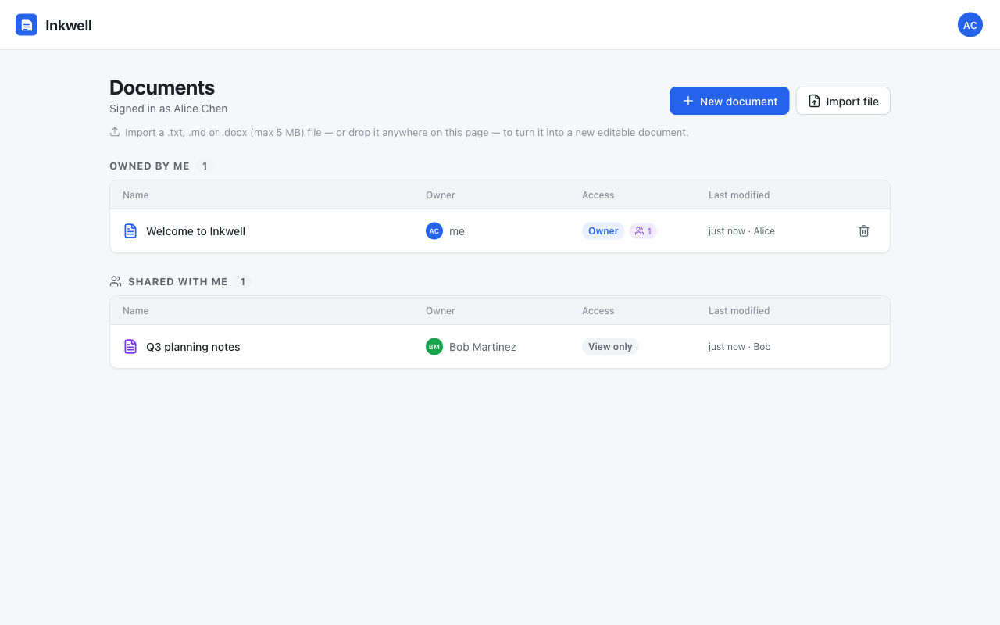
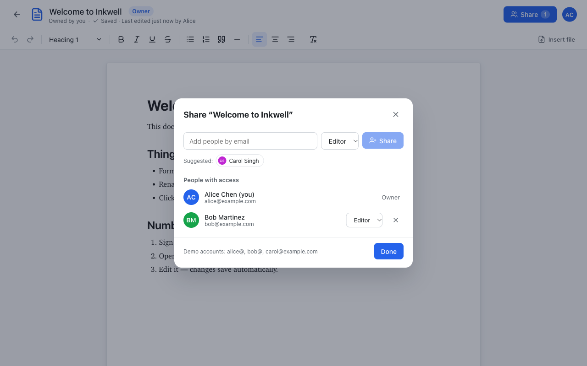
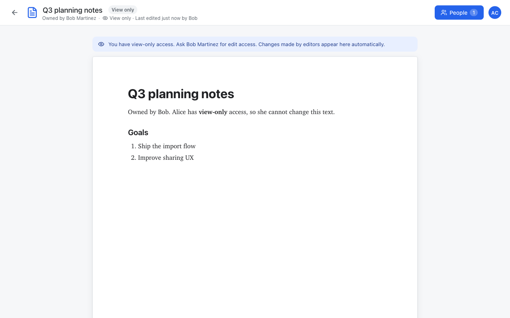

# Inkwell

A lightweight collaborative document editor. You can write and format documents in the browser, import
existing files, and share documents with other users as editors or viewers. Everything is stored in a
local SQLite database.


> **Live demo:** https://sujaychandrakoyyalamudi.github.io/inkwell-docs/
>
> The hosted demo is the browser-only edition. It runs entirely in your browser, and your documents are
> saved on your device. To see sharing, sign in as one user, share a document, then switch accounts from
> the avatar menu. To run the full server-backed version, follow [Quick start](#quick-start). For how the
> two editions differ, see [Deployment](#deployment).

## Contents

- [Quick start](#quick-start)
- [Local setup](#local-setup)
- [Running the app](#running-the-app)
- [Troubleshooting](#troubleshooting)
- [Deployment](#deployment)
- [Features](#features)
- [Walkthrough](#walkthrough)
- [Feature details](#feature-details)
- [Architecture](#architecture) (full write-up in [ARCHITECTURE.md](ARCHITECTURE.md))
- [API reference](#api-reference)
- [Test coverage](#test-coverage)
- [Design decisions](#design-decisions)
- [Limitations and roadmap](#limitations-and-roadmap)
- [AI workflow note](AI_WORKFLOW.md): how this project was built with an AI coding agent
- [Submission summary](SUBMISSION.md): what is included and where each requirement is implemented

---

## Quick start

If you already have Node.js 22.13 or later installed:

```bash
git clone https://github.com/sujaychandrakoyyalamudi/inkwell-docs.git
cd inkwell-docs
npm install
npm run dev
```

Then open **http://localhost:5173** and choose a demo account. There is no password.

The rest of this section explains each step in detail.

---

## Local setup

### 1. Install the prerequisites

| Tool | Required version | Check with |
| --- | --- | --- |
| [Node.js](https://nodejs.org) | **22.13 or later** (an LTS release is recommended) | `node --version` |
| npm | Installed with Node.js | `npm --version` |
| [Git](https://git-scm.com) | Any recent version | `git --version` |

You don't need a separate database server or any other service. SQLite runs inside the Node.js process,
through Node's built-in `node:sqlite` module.

If Node.js is missing or older than 22.13, install the current LTS release in one of these ways:

- **macOS or Linux, with [nvm](https://github.com/nvm-sh/nvm):**

  ```bash
  nvm install --lts
  nvm use --lts
  ```

- **macOS, with Homebrew:** `brew install node`
- **Windows, or any platform:** download the LTS installer from [nodejs.org](https://nodejs.org).

### 2. Get the code

```bash
git clone https://github.com/sujaychandrakoyyalamudi/inkwell-docs.git
cd inkwell-docs
```

The repository is private, so your GitHub account needs access to clone it. You can also download it
from GitHub with **Code → Download ZIP**, unzip it, and open a terminal in the extracted folder.

### 3. Install dependencies

```bash
npm install
```

This installs the project's packages into `node_modules/`. Nothing is compiled from source, so it usually
finishes in under a minute.

### 4. Start the app

```bash
npm run dev
```

This command starts two processes in one terminal:

| Process | Address | Role |
| --- | --- | --- |
| `api` | http://localhost:3001 | Express server: the REST API, file conversion, and the database |
| `web` | http://localhost:5173 | Vite dev server: serves the React app and forwards `/api` requests to the API |

When both are ready, the output looks like this:

```
[api] Inkwell API listening on http://localhost:3001  (db: /path/to/inkwell-docs/data/inkwell.db)
[web]   VITE v8.3.8  ready in 150 ms
[web]   ➜  Local:   http://localhost:5173/
```

Open **http://localhost:5173** in your browser.

The first start creates `data/inkwell.db` and fills it with demo accounts and documents. Later starts
reuse the same file, so your documents are still there.

### 5. Sign in

Sign-in is mocked: click one of the demo accounts. To switch users later, open the avatar menu in the
top-right corner.

| Account | Email | Seeded content |
| --- | --- | --- |
| Alice Chen | `alice@example.com` | Owns *Welcome to Inkwell*, shared with Bob as an editor |
| Bob Martinez | `bob@example.com` | Owns *Q3 planning notes*, shared with Alice as a viewer |
| Carol Singh | `carol@example.com` | No documents. Use this account to test sharing |

### 6. Stop the app

Press **Ctrl+C** in the terminal. This stops both processes. Your data stays in `data/inkwell.db`.

---

## Running the app

### Development mode

```bash
npm run dev
```

Changes to files in `client/` appear in the browser immediately. Changes to files in `server/` restart
the API automatically.

### Production mode

```bash
npm run build
npm start
```

Open **http://localhost:3001**. In this mode a single Node.js process serves both the built app and the
API. Run `npm run build` again after you change anything in `client/`.

### Run the tests

```bash
npm test
```

This runs two suites: 24 tests for the server API and 7 for the browser-only backend. They use temporary
in-memory databases, so they never touch your data, and the app does not need to be running. A
successful run ends with:

```
ℹ tests 31
ℹ pass 31
ℹ fail 0
```

### Reset the demo data

Stop the app first, then run:

```bash
npm run seed:reset
npm run dev
```

This deletes `data/inkwell.db`; the next start recreates the demo accounts and documents. Any earlier
browser session is no longer valid, so sign in again.

### Change the ports or the database location

You can set these environment variables when starting the app:

| Variable | Default | Description |
| --- | --- | --- |
| `API_PORT` | `3001` | API port in development mode. Vite forwards `/api` requests to it |
| `PORT` | `3001` | Server port in production mode (`npm start`) |
| `DB_PATH` | `data/inkwell.db` | Location of the SQLite database file |
| `SEED_DEMO` | `1` | Set to `0` to skip creating the demo documents. Demo accounts are always created |
| `COOKIE_SECURE` | `0` | Set to `1` when serving over HTTPS, so the session cookie is marked `Secure` |

macOS or Linux:

```bash
API_PORT=4000 npm run dev
```

```bash
PORT=8080 npm start
```

Windows (PowerShell):

```powershell
$env:API_PORT=4000; npm run dev
```

The browser-facing port in development (5173) is set by Vite. If that port is busy, Vite picks the next
free one and prints the address it is using.

### npm scripts

| Command | Description |
| --- | --- |
| `npm run dev` | Starts the API and the Vite dev server with automatic reload |
| `npm run build` | Builds the client into `dist/` |
| `npm start` | Runs the production server, which serves `dist/` and the API |
| `npm test` | Runs both test suites (server API and browser-only backend) |
| `npm run seed:reset` | Deletes the local database so the next start re-seeds demo data |
| `npm run dev:static` | Runs the browser-only edition with hot reload (no API server needed) |
| `npm run build:static` | Builds the browser-only edition into `dist/`, as deployed to GitHub Pages |
| `npm run preview:static` | Builds the browser-only edition and serves it at http://localhost:4173 |

---

## Troubleshooting

| Symptom | Cause and fix |
| --- | --- |
| `No such built-in module: node:sqlite` | Node.js is older than 22.13. Upgrade it (see [Prerequisites](#1-install-the-prerequisites)), then run `npm install` again. |
| `npm WARN EBADENGINE` during install | Same cause: Node.js is too old. |
| `npm warn install-scripts … fsevents` during install (macOS) | Harmless. `fsevents` is an optional file-watching helper, and the app works without it. |
| `Error: listen EADDRINUSE … :3001` | Another process is already using port 3001, possibly another copy of the app. Stop that process, or start with a different port: `API_PORT=4000 npm run dev`. |
| The sign-in page shows "Network error — is the server running?" | The API isn't running. Make sure you started the app with `npm run dev`, not `npx vite`, and check the terminal for `[api]` errors. |
| `npm start` shows `Cannot GET /` | The client hasn't been built yet. Run `npm run build` first. |
| You are signed out after resetting the data | Expected: the reset deleted all sessions. Sign in again. |
| `ExperimentalWarning: SQLite is an experimental feature` | Some Node.js 22 releases print this. It is harmless. |

---

## Deployment

**Live demo:** https://sujaychandrakoyyalamudi.github.io/inkwell-docs/

GitHub Pages hosts static files only, so the live demo is a **browser-only edition** of the same app. It
uses the same React interface and the same business rules (`shared/core.js`). In place of the Node
server, the API runs inside the browser on SQLite compiled to WebAssembly.

| | Server-backed (local) | Browser-only (live demo) |
| --- | --- | --- |
| Start it | `npm run dev` or `npm start` | Open the live URL, or `npm run preview:static` |
| Data lives in | `data/inkwell.db` on the server | This browser's `localStorage` |
| Sharing works between | Anyone using the same server | Accounts signed in **in the same browser** |
| Reset | `npm run seed:reset` | Avatar menu → **Reset demo data** |

Everything else behaves the same in both editions: editing, autosave, importing `.docx`, `.md`, and `.txt`
files, sharing roles and permissions, conflict detection (between two tabs, in the browser edition), and
sanitization.

**How it is deployed.** [`.github/workflows/pages.yml`](.github/workflows/pages.yml) runs on every push
to `main`. It installs dependencies, runs all tests, builds the static edition
(`npm run build:static`), and publishes it to GitHub Pages. A failing test stops the deploy. Progress is
visible on the repository's **Actions** tab.

**Hosting the server-backed edition.** For a shared demo that works across devices, [`render.yaml`](render.yaml)
deploys the Node server to [Render](https://render.com) from this repository. It is not deployed at the
moment.

---

## Features

- **Rich-text editing.** Headings, bold, italic, underline, strikethrough, bulleted and numbered lists,
  block quotes, alignment, and undo/redo, from the toolbar or with keyboard shortcuts.
- **Autosave.** Changes save a moment after you stop typing, and a status indicator shows when they are
  saved.
- **File import.** A `.docx`, `.md`, or `.txt` file can become a new document, or its content can be
  inserted into an existing draft.
- **Sharing.** The owner of a document grants **Editor** or **Viewer** access. The dashboard keeps
  *Owned by me* and *Shared with me* separate.
- **Safe concurrent editing.** If two people save over each other, the second save is refused instead of
  silently overwriting the first. Collaborators' changes appear in open documents automatically.
- **Persistence.** Documents, formatting, and sharing are stored in SQLite and survive refreshes and
  server restarts.

## Walkthrough

This takes about two minutes and covers each core feature.

1. **Sign in as Alice.** Her dashboard lists the documents she owns separately from those shared with
   her. Each row shows a role badge.

   

2. **Edit a document.** Open *Welcome to Inkwell*, format some text, and click the title to rename it.
   The status under the title changes from *Unsaved changes* to *Saving…* to *Saved*. Refresh the page,
   and your changes are still there.

3. **Share it.** Click **Share**, add Carol as a **Viewer**, and click **Share** again. In the same
   dialog you can change roles or remove access.

   

4. **Check the viewer's experience.** Switch to Carol from the avatar menu. The document is now
   read-only: the toolbar is hidden and a banner explains the access level.

   

5. **Collaborate.** Switch to Bob, who is an editor, and make a change. Switch back to Carol and the
   change is there. A document that is already open picks up collaborators' saves within a few seconds.

6. **Import a file.** On the dashboard, click **Import file**, or drag a file onto the page. Sample
   files are in [`samples/`](samples).

## Feature details

### Editing

| Action | Toolbar | Shortcut (macOS / Windows) |
| --- | --- | --- |
| Bold, italic, underline | **B** *I* <u>U</u> | ⌘B, ⌘I, ⌘U / Ctrl+B, Ctrl+I, Ctrl+U |
| Strikethrough | S̶ | ⌘⇧S / Ctrl+Shift+S |
| Normal text, Heading 1–3 | Style menu | — |
| Bulleted or numbered list | List buttons | ⌘⇧8, ⌘⇧7 / Ctrl+Shift+8, Ctrl+Shift+7 |
| Block quote, horizontal line, alignment, clear formatting | Toolbar | — |
| Undo or redo | Arrows | ⌘Z, ⌘⇧Z / Ctrl+Z, Ctrl+Shift+Z |
| Save now | — | ⌘S / Ctrl+S |

- **Autosave.** Changes save 0.8 seconds after you stop typing, and whenever the title field loses
  focus. Only one save is sent at a time; edits made while a save is in progress are queued for the next
  one.
- **Leaving the page.** Pending changes are saved before you leave the editor. If a save is still in
  progress, the browser asks before closing the tab.
- **Titles.** Titles are trimmed and capped at 200 characters. An empty title becomes
  *Untitled document*.

### File import

| Format | Extensions | Converter | What is kept |
| --- | --- | --- | --- |
| Word | `.docx` | [mammoth](https://github.com/mwilliamson/mammoth.js) | Headings, bold, italic, underline, strikethrough, lists, links |
| Markdown | `.md`, `.markdown` | [marked](https://marked.js.org) (GitHub-flavored) | Headings, emphasis, lists, block quotes, code, links |
| Plain text | `.txt` | Built in | Paragraphs (separated by blank lines) and line breaks |

- **Two ways to import.** **Import file** on the dashboard, or a file dropped onto the dashboard,
  creates a new document. The dashboard shows the original filename next to it. **Insert file** in the
  editor toolbar puts the content at the cursor.
- **Limits.** One file per upload, up to **5 MB**. The supported types are listed next to every upload
  control, and the server rejects anything else with a clear error message.
- **Not supported.** Embedded images and table layout are dropped; table text is kept as plain text.
  Legacy `.doc` files, PDFs, and other formats are rejected.

### Sharing and permissions

Every document has exactly one **owner**: the user who created or imported it. The owner can share it
with other users by email.

| Capability | Owner | Editor | Viewer |
| --- | :---: | :---: | :---: |
| Open and read | ✓ | ✓ | ✓ |
| See who has access | ✓ | ✓ | ✓ |
| Edit content and rename | ✓ | ✓ | — |
| Insert content from a file | ✓ | ✓ | — |
| Share, change roles, remove people | ✓ | — | — |
| Remove their own access | — | ✓ | ✓ |
| Delete the document | ✓ | — | — |

- **Enforced on the server.** The API checks every permission. The interface only reflects what the API
  allows.
- **No information leaks.** Users without access get **404 Not Found** rather than 403, so they cannot
  tell whether a document exists.
- **Access changes reach open documents.** If your role changes while a document is open, the page
  updates to match within a few seconds. If your access is removed, you see a "Document unavailable"
  page.

### Persistence

- **Storage.** Data lives in a single SQLite file, `data/inkwell.db` by default, using write-ahead
  logging (WAL).
- **Content format.** Documents are stored as sanitized HTML, which is the editor's native format, so
  formatting round-trips exactly. You can inspect the data with any SQLite client:

  ```bash
  sqlite3 data/inkwell.db "SELECT title, updated_at FROM documents;"
  ```

## Architecture

> The design rationale, request flows, security model, and trade-offs are in the
> [architecture note](ARCHITECTURE.md). This section is a quick reference.

### Tech stack

| Layer | Technology |
| --- | --- |
| Frontend | React 19, [TipTap 3](https://tiptap.dev) (built on ProseMirror), Vite, lucide-react icons |
| Backend | Node.js, Express 5, multer (uploads), sanitize-html |
| Database | SQLite via the built-in `node:sqlite` module |
| Browser-only edition | sql.js (SQLite in WebAssembly), DOMPurify, mammoth's browser build |
| Testing | `node:test`, supertest |
| Hosting | GitHub Pages, deployed by GitHub Actions |

### Project structure

```
├── client/                    React single-page app (Vite root)
│   ├── index.html
│   └── src/
│       ├── App.jsx            Session check and routing
│       ├── api.js             REST client (routes to the in-browser backend in the static build)
│       ├── lib.js             Router, formatting helpers, shared constants
│       ├── styles.css
│       ├── static/            In-browser backend for the GitHub Pages build (sql.js, DOMPurify)
│       └── components/
│           ├── Login.jsx          Demo account picker
│           ├── Dashboard.jsx      Owned / shared lists, create, import, drag-and-drop
│           ├── EditorPage.jsx     Editor, autosave queue, conflict handling, live refresh
│           ├── Toolbar.jsx        Formatting controls, insert-from-file
│           ├── ShareDialog.jsx    Grant, change, and revoke access
│           ├── AccountMenu.jsx    Switch user, sign out
│           └── ui.jsx             Avatar, badges, modal, toasts
├── shared/                    Code used by both the server and the browser-only edition
│   ├── core.js                Sessions, documents, sharing, authorization, version checks
│   ├── schema.js              SQLite schema and demo seed data
│   ├── content.js             File conversion, allow-list, limits, title rules
│   └── errors.js              HttpError
├── server/
│   ├── index.js               Entry point and environment configuration
│   ├── app.js                 Express routes on top of shared/core.js
│   ├── db.js                  Opens the SQLite file (node:sqlite)
│   ├── convert.js             Server sanitizer (sanitize-html) and .docx conversion
│   └── reset.js               Deletes the local database
├── tests/
│   ├── api.test.js            Server API tests
│   └── static-backend.test.js Browser-only backend tests
├── .github/workflows/pages.yml  Test, build, and deploy to GitHub Pages
├── render.yaml                Optional Render deployment of the server-backed edition
├── ARCHITECTURE.md            Architecture note
├── AI_WORKFLOW.md             AI workflow note
├── SUBMISSION.md              Submission summary and file manifest
├── samples/                   Example .docx, .md, and .txt files
└── docs/screenshots/          Images used in this README
```

### Data model

```sql
users            (id, email UNIQUE, name, color)
sessions         (token PK, user_id → users, created_at)
documents        (id UUID PK, owner_id → users, title, content, version,
                  source_filename, created_at, updated_at, updated_by → users)
document_shares  (document_id → documents, user_id → users,
                  role CHECK IN ('viewer', 'editor'), created_at,
                  PRIMARY KEY (document_id, user_id))
```

Foreign keys cascade on delete, so deleting a document also removes its shares.

### How saving works

1. The editor sends `PATCH /api/documents/:id` with the new content and the `version` it was based on.
2. The server applies the change only if that version is still current, using a single conditional
   `UPDATE … WHERE version = ?`. On success it increments the version.
3. If another user saved first, the server returns **409 Conflict** along with the latest copy. The
   editor then shows a banner with two choices: **Load their version** or **Keep mine**.
4. Open documents poll every 4 seconds. While you have no unsaved changes, newer versions are applied
   without affecting your undo history.

## API reference

All endpoints are under `/api` and use JSON, except file uploads, which use `multipart/form-data` with
the file in a field named `file`. Every endpoint except `/users` and `/auth/*` requires a session
cookie.

| Method | Endpoint | Access | Description |
| --- | --- | --- | --- |
| `GET` | `/users` | Public | Lists demo accounts |
| `POST` | `/auth/login` | Public | Starts a session. Body: `{ email }` |
| `POST` | `/auth/logout` | Signed in | Ends the session |
| `GET` | `/auth/me` | Public | Returns the current user, or `null` |
| `GET` | `/documents` | Signed in | Returns `{ owned, shared }` document lists |
| `POST` | `/documents` | Signed in | Creates a document. Body: `{ title?, content? }` |
| `POST` | `/documents/import` | Signed in | Creates a document from an uploaded file |
| `GET` | `/documents/:id` | Any role | Returns the document, including the caller's role |
| `PATCH` | `/documents/:id` | Owner, editor | Saves changes. Body: `{ title?, content?, version }`. Returns `409` on a version conflict |
| `DELETE` | `/documents/:id` | Owner | Deletes the document |
| `GET` | `/documents/:id/shares` | Any role | Lists the owner and collaborators |
| `POST` | `/documents/:id/shares` | Owner | Grants access or changes a role. Body: `{ email, role }` |
| `DELETE` | `/documents/:id/shares/:userId` | Owner, or that user | Revokes access, or leaves the document |
| `POST` | `/convert` | Signed in | Converts an uploaded file to HTML without saving it |

Errors use the shape `{ "error": "message" }` with a matching HTTP status code.

## Test coverage

There are 31 tests (see [Run the tests](#run-the-tests)): 24 for the server API and 7 for the
browser-only backend. The browser suite runs the same core on sql.js and covers sharing rules, conflicts,
imports, persistence across reloads, syncing between tabs, and resetting the demo. The server API tests
cover:

- **Authentication.** Session required, sign-in and sign-out, unknown accounts.
- **Documents.** Create, rename, edit, and reopen with formatting preserved; input validation; delete.
- **Security.** Scripts, event handlers, and `javascript:` URLs are removed from stored content.
- **Concurrency.** A save based on an outdated version is rejected with `409`.
- **Sharing.** Viewers are read-only. Editors can edit but cannot manage access. Revoking and leaving
  work. Outsiders get `404`. Deleting a document removes it for collaborators.
- **Import.** `.docx`, `.md`, and `.txt` conversion using the files in `samples/`; unsupported,
  oversized, and corrupt files are rejected.
- **Persistence.** Data survives closing and reopening the database file.

The user-interface flows were verified manually in the browser: editing, autosave, sharing, switching
users, view-only mode, conflict resolution, file import, and the mobile layout.

## Design decisions

- **Mock authentication, real sessions.** Picking an account creates a server-side session: a random
  token stored in an `HttpOnly`, `SameSite=Lax` cookie. All authorization runs on the server against
  that session, so adding real authentication would only change the login endpoint.
- **HTML as the storage format.** File imports produce HTML, and the editor reads and writes it
  natively, so the stored content is easy to inspect. Every write and import is sanitized against an
  allow-list that matches the editor's schema. This prevents stored cross-site scripting even if a client
  bypasses the editor.
- **Optimistic concurrency instead of real-time co-editing.** Version checks keep concurrent saves from
  overwriting each other, and they are simple and predictable. Real-time co-editing, for example with
  Yjs or CRDTs over WebSockets, is a larger investment and the natural next step.
- **Built-in `node:sqlite`.** It needs no native build step and no separate database server, so the
  project installs on any machine with a recent version of Node.
- **One deployable unit.** In development, Vite serves the client with hot reload. In production,
  Express serves the built client and the API from a single process.

## Limitations and roadmap

| Limitation | Possible next step |
| --- | --- |
| Two people cannot type in the same document live | Real-time co-editing with Yjs and TipTap's collaboration extension |
| No version history | Store a snapshot of each save in a `document_revisions` table, with restore |
| Sharing works only with existing accounts | Invitation emails, shareable links, and groups |
| Server-side sessions do not expire, and there is no CSRF token | Session expiry and rotation; CSRF protection once real auth is added |
| Imports drop images and tables | Add image upload storage and the TipTap table extension |
| No automated browser tests | End-to-end tests with Playwright |
| The live demo keeps data in each visitor's browser | Deploy the server-backed edition (`render.yaml` is ready) for a shared, multi-device demo |
